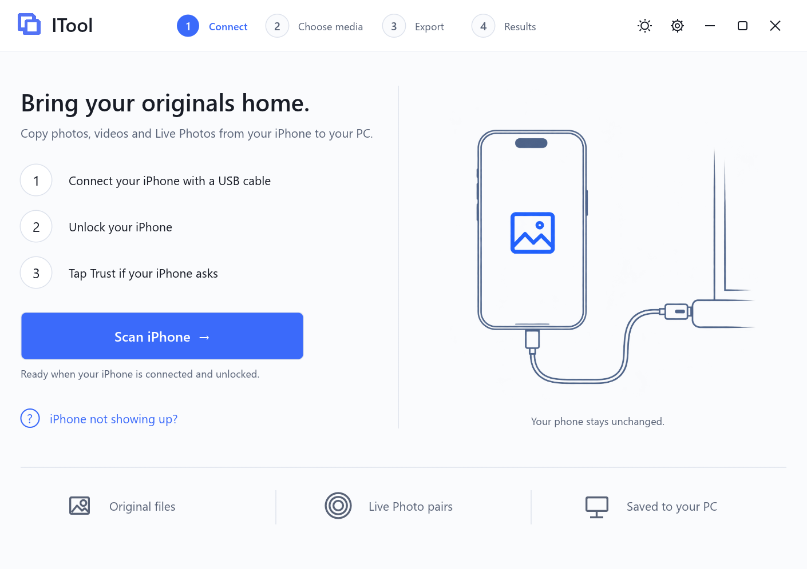
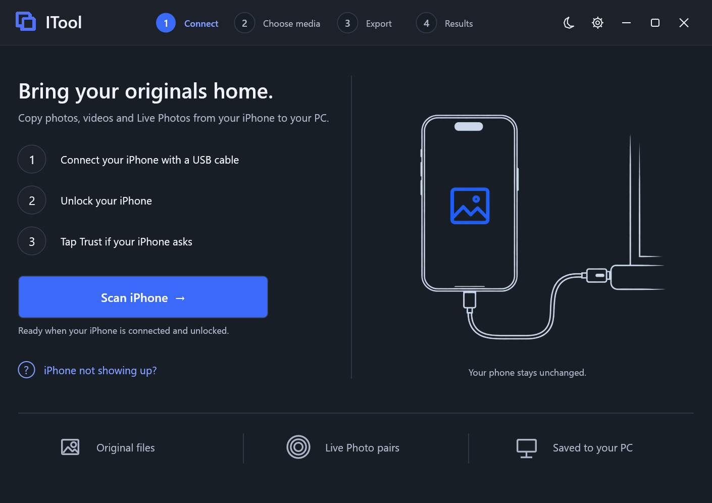
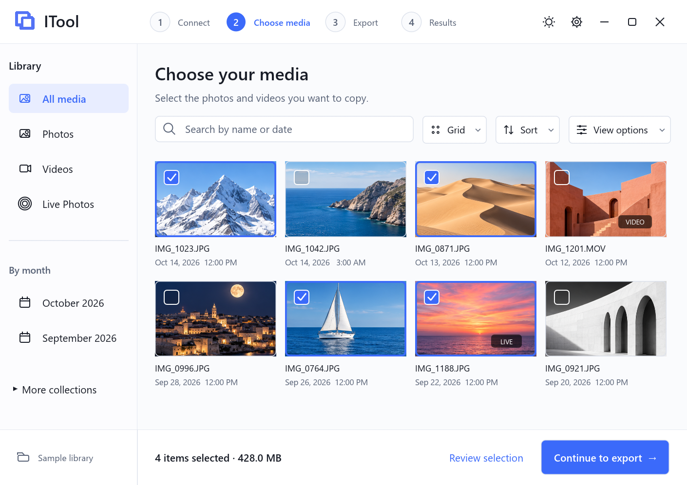
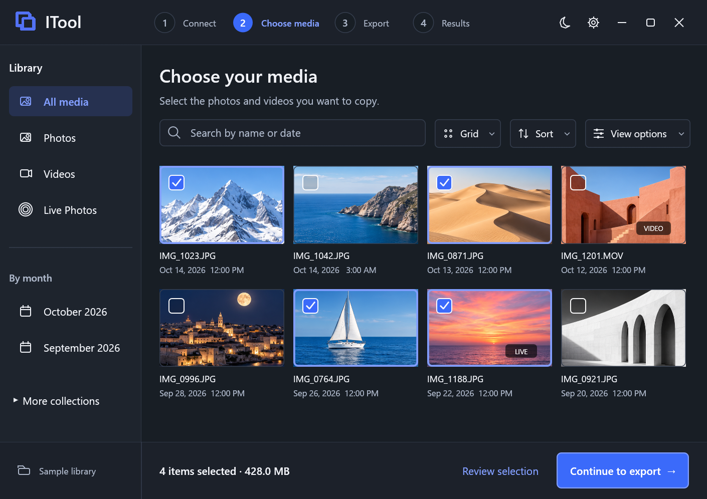
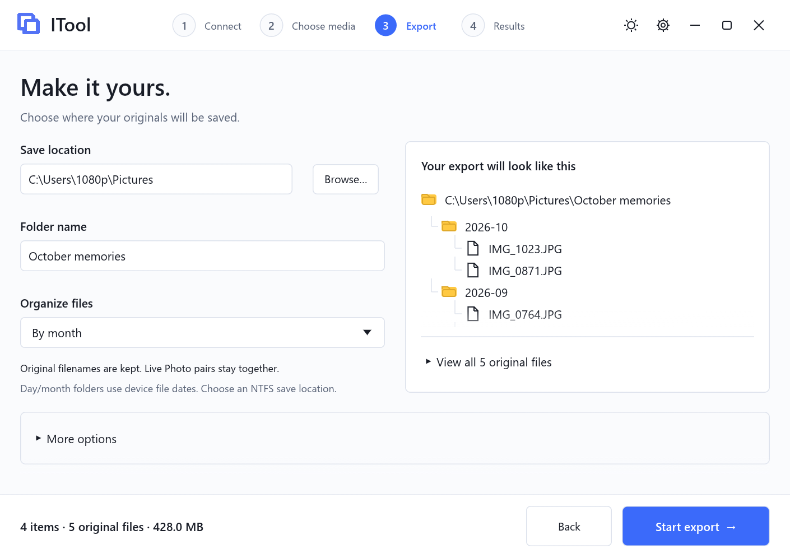
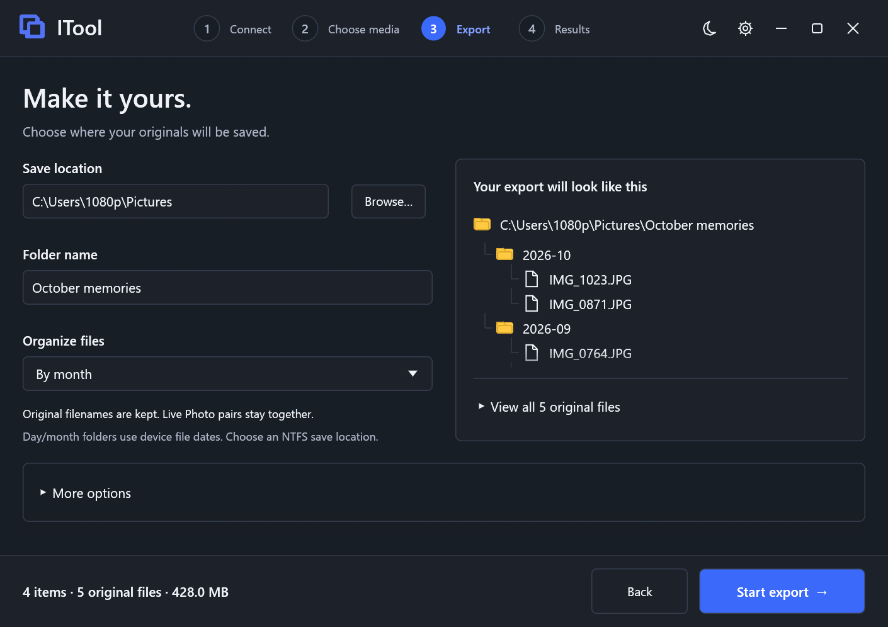
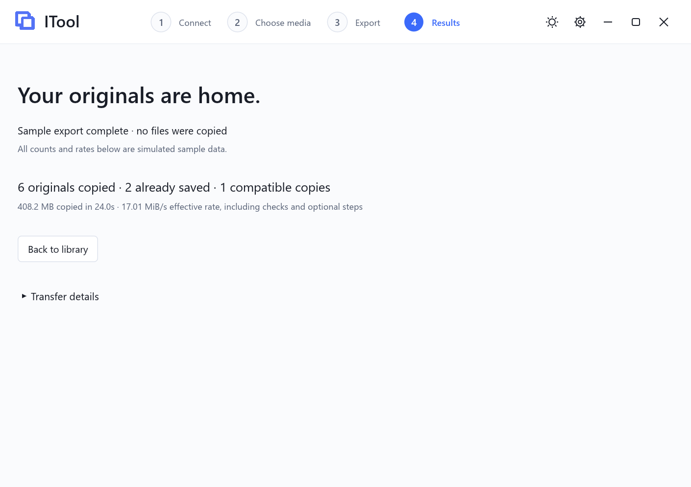
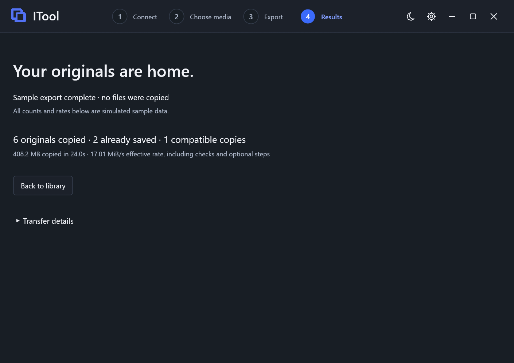

# ITool

A native Windows app and CLI for copying accessible iPhone photos, videos and Live Photo resources over USB. Original files are copied without conversion. Optional compatible copies are additional files.

Download [ITool v0.3.0 for Windows x64](https://github.com/Marshmellow31/ITool/releases/tag/v0.3.0). Choose the portable ZIP or standalone desktop EXE. The guided UI and features below are included; local builds and demo screenshots do not establish physical-device behavior.

## Screenshots

Actual screenshots of the Windows development build in demo mode. The library uses synthetic sample photos; export counts and rates are simulated. Select an image to view it at full size.

### 1. Connect

Connect your iPhone, unlock it and confirm Trust before scanning.

| Light mode | Dark mode |
| --- | --- |
|  |  |

### 2. Choose media

Browse the library, filter and sort media, and review your selection.

| Light mode | Dark mode |
| --- | --- |
|  |  |

### 3. Export

Name your export folder, choose how files are organized, and preview the destination.

| Light mode | Dark mode |
| --- | --- |
|  |  |

### 4. Results

Review the export summary and transfer details. This screenshot shows simulated demo results.

| Light mode | Dark mode |
| --- | --- |
|  |  |

## Guided workflow

1. **Connect:** connect one iPhone using a data-capable cable, unlock it, confirm Trust, then choose **Scan iPhone**. Setup help is available on this screen.
2. **Choose media:** use the grid or details list, search, media-type/month filters, available Albums/Favorites, and Sort/View options. Click, Shift-click, drag or select a group. Select/invert shown items and review the selection basket. Selection survives filters. Ctrl+A selects shown items; Escape clears selection outside text inputs.
3. **Export:** choose an existing save location, edit the new folder name, and preview its contents. Choose flat, day, month, media-type or DCIM source folders. Existing output folders and duplicate relative names block export. Change the name or choose Source folders to resolve conflicts. Gallery grouping and output layout are independent.
4. **Results:** see progress, cancel, inspect copied/skipped/converted resource counts and optional-step notes, and open the output folder. Cancellation preserves completed originals.

Neutral light/dark palettes use a blue accent. Appearance is saved in `%APPDATA%\ITool\preferences.json`. The desktop executable suppresses its console window; the separate CLI retains its console.

## Only copy new files

Enable **Only copy new files** on Export. Local history lives in `.itool-history` inside the save location. Reuse that parent for future batches, with a new batch folder name each time.

History is separated by a SHA-256 hash of the device identifier. A skip requires matching device/source path, size, filesystem creation/modification dates, and a saved original that still matches its stored SHA-256. Missing, modified or unknown saved copies are copied again. If one selected Live Photo resource needs copying, both are copied into the new batch. Requested conversion/timestamp options also affect skip eligibility.

This is metadata-based incremental detection with local-copy verification, not a new source digest. Source content changed without changing those metadata values cannot be detected. Moving/deleting history loses skip knowledge; older exports without history are copied again. This does not resume partial files or synchronize deletions. History contains private paths; keep it private.

## Additional JPEG and MP4 copies

Under **More options**, request JPEG copies of HEIC/HEIF and/or H.264/AAC MP4 copies of SDR MOV/M4V. Originals remain intact. Copies use names such as `IMG_1023.HEIC.jpg` and `IMG_1023.MOV.mp4` to distinguish them from originals.

Local **FFmpeg** is required; MP4 conversion also requires **ffprobe**. The app looks in a `tools` folder beside the executable, then on PATH. Settings shows availability. ITool does not download these tools or redistribute them in its portable package. See [FFmpeg downloads](https://ffmpeg.org/download.html).

Codec support depends on the installed build. Decode/encode failures become notes while preserving originals. HDR videos and videos with missing color-transfer metadata are skipped for conversion. Compatible copies can change compression, color and metadata; they are not archival substitutes. Converted pairs are not guaranteed to reimport as Apple Live Photos.

## Capture timestamps

Enable **Use embedded capture dates for saved file timestamps**. ITool reads EXIF DateTimeOriginal/OffsetTimeOriginal, including supported HEIF images, and can use ffprobe for video/container creation metadata. On Windows it sets destination creation/modification times without changing file contents.

A date without an offset uses the PC timezone and produces a note. Missing, ambiguous or unreadable dates leave destination timestamps unchanged and are reported. Video container creation time is not necessarily camera capture time. Gallery dates and day/month folders still use device filesystem dates, independently of this option.

## Albums and Favorites

The scan attempts a bounded read-only copy of `/PhotoData/Photos.sqlite` and its WAL when exposed by iOS. SQLite runs only on a private temporary local snapshot, discarded afterward. The reader supports `ZASSET`/`ZGENERICASSET`, Favorite flags and discoverable album join tables. Snapshots whose source metadata changes during copying or which fail consistency checks are rejected.

iOS can deny access and its private schema can change. Unsupported filters are disabled and availability is explained. Only metadata mapped to accessible DCIM originals is shown. DCIM folders are not Photos albums; cloud-only originals are not fetched. No jailbreak, database writes to the device or authentication bypass is used. Physical-phone access and schema compatibility remain unverified.

## Folder and integrity behavior

- Each batch creates the exact new folder shown on Export. Original names and grouped Live Photo resources are retained.
- Use an **NTFS** save location. Final publication uses hard links to avoid overwriting. exFAT/FAT destinations are not supported by this implementation.
- `completed.json` checkpoints originals copied in this batch. Unfinished files retain `.partial` and are not treated as complete.
- `transfer.json` records original evidence, skipped paths, compatible copies, options and notes. An all-skipped batch may contain reports without new originals.
- Original verification compares received-stream SHA-256 with a destination reread and checks source size/mtime. It is not an independent device-side digest.
- A different connected iPhone from the scanned device blocks desktop export until rescanning.
- Device access initiated by this app is read-only. Reports/history contain private paths and should remain private.
- The transfer default is **4 MiB**. USB 3 performance and improvement over smaller buffers require hardware benchmarks; no 10 Gbit/s throughput claim is made.

## Requirements

Windows 10/11 x64, Apple Mobile Device Support through Apple Devices or iTunes, one trusted USB-connected iPhone and an NTFS save location. Originals must be available through the device media service; thumbnails do not prove original availability. Optional FFmpeg/ffprobe enables compatible copies and video timestamps. EXIF parsing is built in.

Start `itool-desktop.exe` for the guided interface or `itool.exe` for CLI workflows.

## CLI examples

```powershell
.\itool.exe devices
.\itool.exe list /DCIM
.\itool.exe find IMG_3119.HEIC IMG_3119.MOV
.\itool.exe library
.\itool.exe library --favorites
.\itool.exe library --album "Travel"

# Destination is a NEW directory inside an existing parent
.\itool.exe export --dest D:\Photos\Batch-1 /DCIM/123APPLE/IMG_3119.HEIC /DCIM/123APPLE/IMG_3119.MOV
.\itool.exe export --dest D:\Photos\Batch-2 --new-only --capture-timestamps --jpeg-copies --mp4-copies /DCIM/123APPLE/IMG_3119.HEIC /DCIM/123APPLE/IMG_3119.MOV

# Override transfer chunks: 64–8192 KiB, default 4096
.\itool.exe export --dest D:\Photos\Batch-3 --chunk-kib 4096 /DCIM/123APPLE/IMG_3119.MOV
.\itool.exe verify --baseline .\manifest.json --dir D:\Photos\Batch-1
```

Include both still and clip paths for Live Photos through the exact-path CLI. Desktop selection expands both automatically. The existing baseline verifier expects flat original files.

## Build and sample screens

Rust edition 2024. Build optimized Windows binaries:

```powershell
cargo build --release --features desktop --bins
```

Device-free sample mode simulates the guided flow without connecting to an iPhone or copying files. Opening synthetic output paths is disabled:

```powershell
.\target\release\itool-desktop.exe --demo
.\target\release\itool-desktop.exe --demo --demo-connect
.\target\release\itool-desktop.exe --demo --demo-review
.\target\release\itool-desktop.exe --demo --demo-results
# Add --demo-light or --demo-dark to choose the theme, or --demo-list for details view.
```

Tests, when authorized, run separately with `cargo test --all-targets --features desktop`. Builds and sample screens do not establish physical-device behavior.

## Roadmap status

Implementation status below is **verified in source**, not proof of physical-device behavior. Future items are **recommendation-not-fact**; research items **need confirmation**. Priorities describe a suggested order, not release dates or commitments.

| Existing capability | Status | Remaining validation |
| --- | --- | --- |
| Organized exports and editable batch folders | Implemented in source | Device exports, filename conflicts and destination behavior |
| Incremental exports with checked local history | Implemented in source | Device changes, modified/missing saved copies and interrupted batches |
| Additional JPEG/MP4 copies | Implemented in source; local FFmpeg/codecs required | Media quality, playback, orientation and failure handling |
| Capture timestamps | Implemented in source with fallbacks | Known media dates, timezone handling and NTFS timestamps |
| Conditional Albums/Favorites | Implemented in source | Physical-phone access, schema compatibility and mapping accuracy |

### Future scope

Full evidence, implementation boundaries, relative effort, acceptance checks and milestone details are in [FUTURE_SCOPE.md](docs/FUTURE_SCOPE.md). Every addition must preserve original media, avoid overwriting existing files and keep device access read-only.

| Order | Future capability | What it adds | Status / key condition |
| --- | --- | --- | --- |
| First | Validate the current build | Device, interruption, disk-full and long-batch checks | Pending; follow [validation handoff](docs/VALIDATION_HANDOFF.md) before claiming support |
| 1 | Export preflight | Required bytes, free space, filesystem, permissions, conflicts and tool checks | Proposed; conversion space remains an estimate |
| 2 | Retry failed items and recover batches | Reconnect or restart the app and finish remaining originals | Proposed; revalidate identity/source and completed copies; restart unfinished files from zero initially |
| 3 | General archive verification | Detect missing or modified files in grouped exports without a phone | Proposed; verify local files against recorded hashes; reject unsafe manifest paths |
| 4 | Media details and metadata sidecars | Dimensions, duration, codecs, capture dates and available album/favorite data in JSON/CSV | Proposed; record provenance and unknowns; location metadata opt-in |
| 5 | Stronger Live Photo, RAW+JPEG and edit-resource handling | Better resource association and preservation of accessible AAE/edit sidecars | Proposed; retain originals; asset mapping and Apple reimport compatibility need confirmation |
| 6 | Large-library browsing and offline previews | Progressive scanning, optional persistent preview cache, prior-export browsing and richer filters | Proposed; bounded, device-scoped, clearable cache; previews never substitute for originals |
| 7 | Album output and export presets | Reusable settings and organization by actual Photos albums | Proposed; define multiple-album membership and name conflicts; start with an album index |
| 8 | Byte-offset pause/resume | Continue partway through a large video | Research; validate the partial prefix and source before appending, then verify the complete copy |
| 9 | exFAT external-drive export | Save directly to common portable SSDs | Research; replace NTFS-dependent finalization while preserving no-overwrite behavior |
| 10 | Measured performance tuning / USB 3 benchmarks | Compare buffer sizes and investigate bounded read/write/hash overlap | Proposed measurement, then experiments; no speed or link-rate claim without hardware evidence |
| 11 | HDR-to-SDR and Live Photo viewing copies | Additional playback-friendly derivatives | Research; validate color, orientation and audio sync; originals stay intact |
| Metadata research | Broader Photos-schema coverage | More reliable album/favorite/resource mapping across supported iOS versions | Needs confirmation; unsupported or inconsistent snapshots must remain clearly unavailable |
| Optional | Read-only device overview | Model, iOS version, connection state and accessible-media storage | Needs confirmation per field; distinguish media-volume capacity from whole-device capacity |
| Optional | Battery and diagnostic information | A small set of useful read-only device values | Research; symbols alone do not establish battery health, repair history or part authenticity |
| Optional | Accessible-file browser | Browse permitted paths and copy files to the PC | Proposed; begin with media paths; no device delete, rename or upload |
| Optional | Local Apple/iCloud export-folder import | Organize and verify user-selected local media | Proposed; keep provenance separate from USB and verify actual downloaded bytes |
| Separate discovery | Contacts, messages and local-backup inspection | Explore explicit user-selected local backups | Needs confirmation; separate privacy/access/encryption design; no recovery or decryption promise |
| Deferred | Direct cloud-only original retrieval | Access originals absent from USB-visible storage | Unproven; first provide unavailable-original status and an Apple-supported download handoff |

Device cleanup/deletion, two-way sync, Photos database writes, firmware restore/flashing, jailbreak/AFC2 access, lock bypass and backup-password manipulation are outside this read-only roadmap. See the [scope boundaries](docs/FUTURE_SCOPE.md#deferred-work-and-scope-boundaries).

Historical evidence: an earlier CLI copied seven resources totaling 185,252,866 bytes in 11.178 seconds, matching a 3uTools sample byte-for-byte. The 3uTools batch was not timed. This does not validate the new UI or roadmap features.

## References and license

EXIF parsing uses [kamadak-exif](https://docs.rs/kamadak-exif/latest/exif/). Photos schema discovery is informed by [iLEAPP's Photos metadata parser](https://github.com/abrignoni/iLEAPP/blob/main/scripts/artifacts/photosMetadata.py); this does not establish AFC database accessibility on a particular iPhone.

MIT licensed. Apple and iPhone are trademarks of Apple Inc. ITool is independent.
