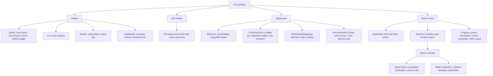

# ITool redesign working plan

Original source inventory: 25 October 2026. Updated 26 October: the user authorized implementation and building. The guided UI and roadmap features are now implemented in source; tests, rendered UI checks and physical-device validation remain paused. The original inventory below documents the previous layout, not the new one.

## Decisions

- Selected: guided flow, Connect → Choose media → Export → Results.
- Implemented direction: a new editable named folder inside the selected parent, as shown in the accepted export mockup. Direct export into an existing folder remains unsupported.
- Requested: reorganize the whole interface, simpler user language, proper logo, and implement the README roadmap.
- Desktop console suppression is included in the rebuilt GUI target; launch behavior is not observed in this pass.
- Existing local 4 MiB transfer default remains in scope; speed improvement is unverified.

## Current feature placement (verified by source inspection)

The separate CLI offers devices, list, find, export, and baseline verification. Demo mode uses synthetic media and disables device operations.

## Implemented placement

1. Connect: connection instructions, Apple support setup help, scan action and status.
2. Choose media: library sidebar, search and filters, gallery/details; secondary view options together; a selection basket with a clear Continue action.
3. Export: destination, folder name/mode, organization options, visible folder-tree preview, selected item/resource summary and conflicts. Keep detailed resource paths behind an expandable detail view.
4. Results: active copy progress and cancellation, then completed/incomplete summary, recovery actions when supported, and Open folder. Technical reports remain available under details.

Global settings: theme and remembered preferences. Future conversion and timestamp options belong to Export; incremental export entry and history need source-backed state rather than guessed completion flags.

## Previous folder behavior (before this redesign)

Choosing Review creates a planned child path named `ITool-YYYY-MM-DD_HH-MM-SS-mmm` under the selected parent. Actual creation occurs at transfer start. Desktop defaults to day subfolders; flat, month, media type and DCIM source-folder layouts are also available. Original filenames and Live Photo resource grouping are preserved. Existing roots are rejected; duplicate relative output names block copying. Reports live in the export root, and incomplete resources retain a `.partial` suffix. Final publication currently uses hard links, so destination filesystem compatibility must be addressed before promising arbitrary external-drive support.

Proposed: editable readable folder names, exact destination/tree preview, explicit conflict handling, no silent overwrites, and clear distinction between browsing groups and output folders. Direct export into existing folders needs changes to collision handling, checkpoints and report ownership; it is not a label-only change.

## README roadmap

- Organized exports: already present in source; redesign the choices and folder preview.
- Incremental sync: implement local export history/identities and safe skip decisions. Filename equality alone is insufficient.
- Optional format conversion: create additional compatible copies while retaining originals and Live Photo resources. Codec, HDR and metadata behavior need investigation before promising universal JPEG/MP4 compatibility.
- Capture timestamp preservation: extract embedded capture metadata, define timezone/missing-date behavior, and apply appropriate destination timestamps without changing original contents.
- Albums and Favorites: investigate access on a trusted, unmodified iPhone; then implement only metadata actually available. DCIM directories are not Photos albums.

Related gaps explicitly disclosed in README: automatic resume is absent, current displayed dates come from filesystem creation time, and cloud-only original availability is not guaranteed. Treat resume/recovery and cloud-only messaging as separately scoped work, not already implemented roadmap features.

README cleanup: remove unsupported absolute safety/privacy/performance statements and unsupported competitor generalizations; distinguish source behavior, historical sample evidence, and unverified live behavior. Correct the Rust edition badge to match Cargo.toml (2024).

## Decision sequence

1. App flow (selected).
2. Export destination and folder behavior (awaiting answer).
3. Navigation grouping and defaults, including where future features fit.
4. Visual direction and logo concept; then produce the selected logo and app icon assets.
5. Implement the redesigned screens and export behavior.
6. Implement roadmap work in scoped stages with metadata-access feasibility first for Albums/Favorites.
7. Build, visual checks and real-device checks only when the user lifts the verification pause. Do not claim completed validation before then.

## Implementation update — 26 October 2026

The accepted light/dark blue mockups guided the new shell. The desktop now has all four screens, grouped controls, source-aware collection filters, export options and clearer outcome reporting. Backend modules are `src/library.rs` and `src/workflow.rs`. The original gallery selection/virtualization logic is retained under `src/bin/desktop/gallery.rs`. The executable uses a clean geometric PNG/ICO/SVG logo derived from the approved frame concept.

README now distinguishes code implementation, conditional metadata/codec support, historical evidence and unverified physical-device behavior. Build results and portable output paths are reported in the handoff. This update does not publish a new release. No commits or pushes are implied.
